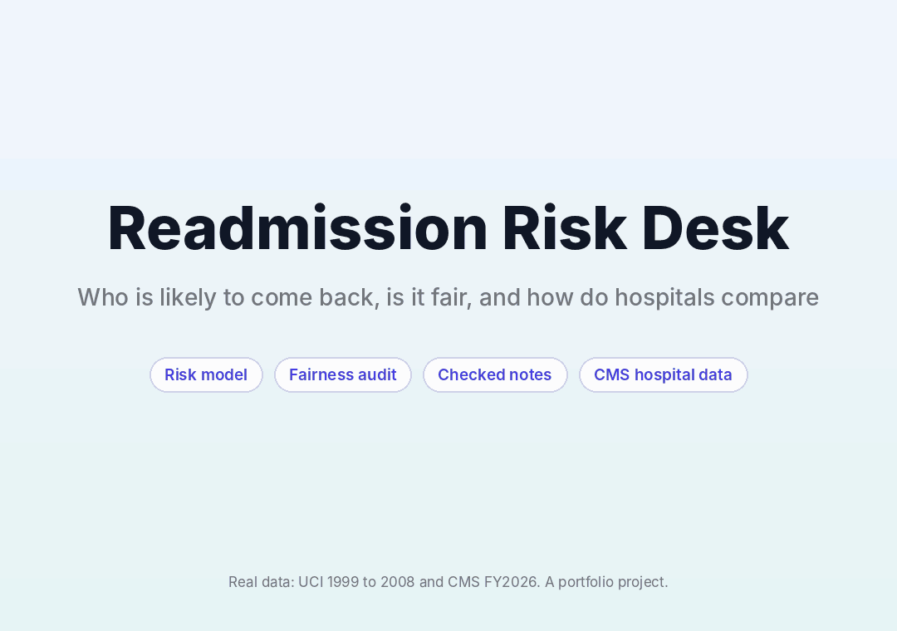
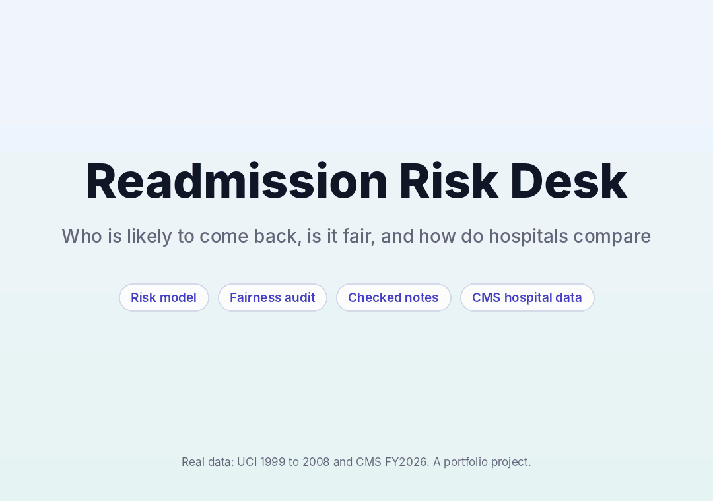

# Readmission Risk Desk

A hospital readmission project with three parts: a patient level risk model, a fairness audit, and a look at how US hospitals compare today. A checked note explains each flagged discharge using only facts from the data.

**Live demo:** add your Streamlit link here



The Report tab is a Power BI style page: slicers for gender, race, age and diagnosis filter every card and chart. The other tabs hold the full tour.



## The question

Hospitals want to know which patients are most likely to return within 30 days of discharge, so a care team can follow up with the right people. This project asks how well that can be done with routine hospital records, whether the ranking treats groups fairly, and how hospitals differ.

## What I found

**Patient model** (99,340 stays, 69,987 patients, split by patient so nobody appears in both train and test)

| Model | AUC (95% interval) | Hit rate in top 15% | Lift |
|---|---|---|---|
| Rule: count of prior inpatient stays | 0.628 (0.614 to 0.642) | 21.7% | 1.89 |
| Logistic regression | 0.658 (0.645 to 0.675) | 23.8% | 2.08 |
| Gradient boosting (final) | 0.671 (0.658 to 0.686) | 24.0% | 2.10 |

- The base rate is 11.4%. Calling the top 15% of discharges finds 31.5% of all readmissions.
- The gain over a simple rule is real but small. Readmission is hard to predict from these records.
- Predicted risks are well calibrated. In every tenth of the test data the mean predicted risk is within about 1.1 percentage points of the observed rate.

**Fairness audit** (race and gender are not model inputs, only used to check)
- Black patients are flagged slightly more often than white patients (17.0% against 14.9%), with a higher false alarm rate (14.8% against 12.7%).
- The model catches 25.0% of readmissions in patients 80 and over, against 47.7% in patients under 40.

**Hospitals today** (CMS FY2026, 3,055 hospitals, July 2021 to June 2024)
- State median ratios run from 0.962 in Oregon to 1.031 in Massachusetts. This shows a regional pattern, not a cause.
- Hospitals that struggle with one condition tend to struggle with others. Heart failure and pneumonia ratios correlate at 0.37, and 7.5% of hospitals are worse than expected on every condition they report, against about 5.4% if conditions were independent.

## The checked note writer

The same pattern as my other projects: facts are computed and formatted first, a writer may only use those facts, and a checker rejects any note that cites an unknown fact, uses a number that is not in the cited facts, claims a cause, or skips the required risk and limits statements. One retry with feedback is allowed. The default writer is rules only and needs no API key. A Gemini writer is included but I have not run it against the live service.

In 3,200 deliberately broken notes (8 kinds of error across 400 discharges) the checker caught 3,199. The miss was a wrong number that happened to equal another number in the same finding, because the checker confirms a number appears in the cited facts, not that it sits in the right sentence.

## Honest limits

- The patient data are from 1999 to 2008. Treat this as a demonstration of method, not a tool for use today.
- Accuracy is modest (AUC 0.67).
- The patient data and the CMS data cannot be linked, so they are shown side by side.
- The CMS file has no hospital ownership or type, so the hospital comparison covers state, condition and size only.
- I tried isotonic recalibration. It did not improve the Brier score and produced implausible risks (up to 99.5%) in sparse regions, so the raw model is used.
- Readmissions to other hospitals may be missed.

## Run it

```
pip install -r requirements.txt
streamlit run app.py
```

The dashboard reads the files in `data/` and `eval/`, so it needs no raw data. To rebuild everything:

1. Download the data (not stored in this repo):
   - [UCI Diabetes 130-US hospitals](https://archive.ics.uci.edu/dataset/296/diabetes-130-us-hospitals-for-years-1999-2008): put `diabetic_data.csv` and `IDS_mapping.csv` in `data/raw/`.
   - CMS Hospital Readmissions Reduction Program (FY2026) from data.cms.gov: save as `data/raw/hrrp_fy2026.csv`.
2. `pip install -r requirements-dev.txt`
3. `python src/model.py`, then `python src/cms.py`, then `python src/evaluate_notes.py`
4. `pytest tests`

## Data and citation

Strack, B. et al. (2014). Impact of HbA1c Measurement on Hospital Readmission Rates. BioMed Research International. Check the license on the UCI page before reusing the data. CMS data are public.

## Layout

`src/prep.py` cleaning, `src/model.py` model and audit, `src/cms.py` hospital layer, `src/note.py` findings, `src/checker.py` writer and checker, `src/evaluate_notes.py` checker test, `app.py` dashboard, `tests/` 17 tests.
